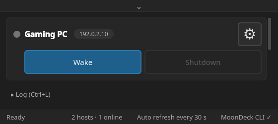
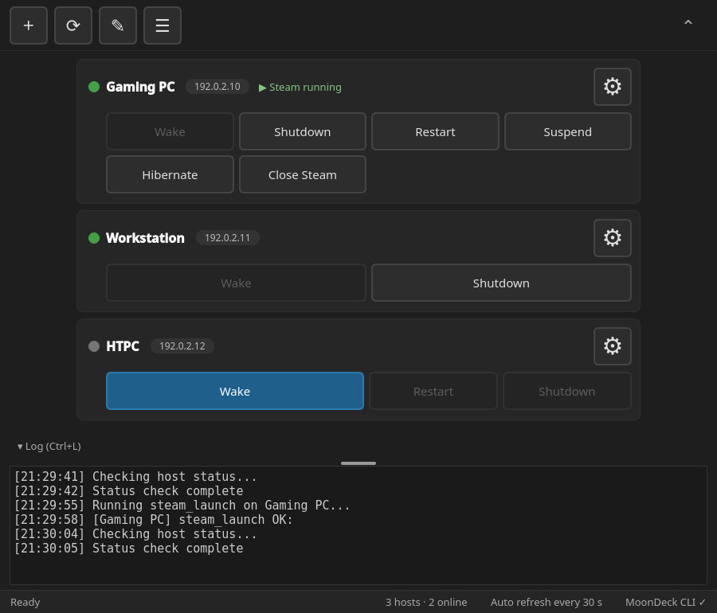
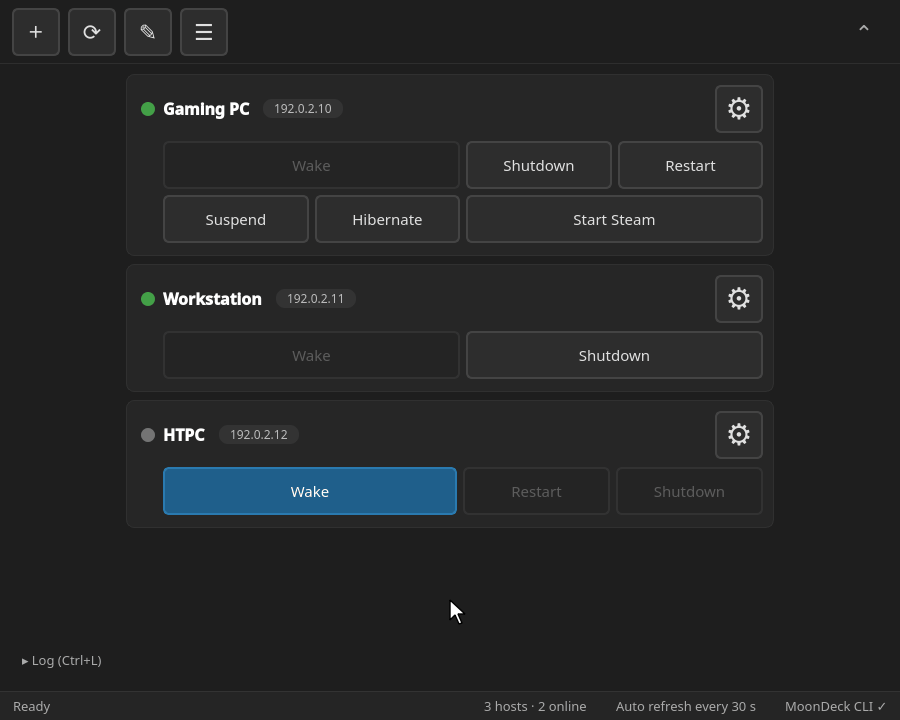
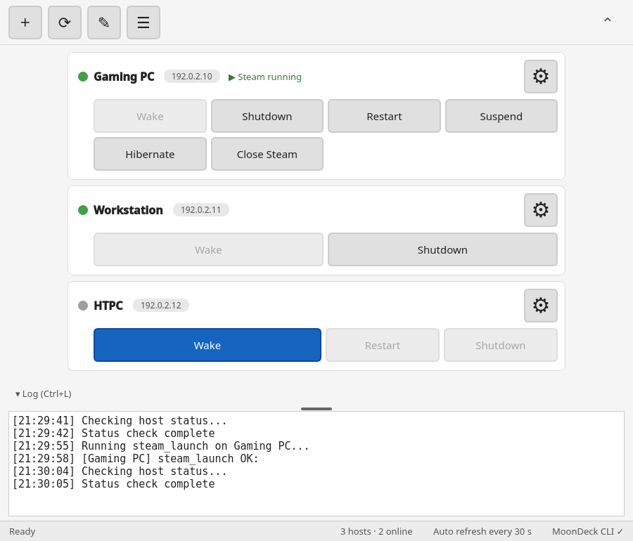

<div align="center">

# BuddyRemote

### Download. Run. Pair. Done.

**Simple remote PC control. No complicated setup.**

A lightweight, free and open-source **Linux GUI** for controlling **Windows and Linux PCs** on your home network via [MoonDeck Buddy](https://github.com/FrogTheFrog/moondeck-buddy).

[**Download the latest release**](https://github.com/deciderino/BuddyRemote/releases) · [Manual](docs/MANUAL.md) · [Report an issue](https://github.com/deciderino/BuddyRemote/issues)

</div>

---

## What is BuddyRemote?

BuddyRemote lets you **wake, shut down, restart, suspend, or hibernate** your PCs from a simple graphical interface on Linux. It **starts Steam on the host and closes it again with the same tile.**

It was made for **Linux HTPCs, Steam Deck Desktop Mode, and home game streaming setups**, but you don't need a game streaming session to use it. Power controls work independently of Steam, Sunshine, Apollo, and Moonlight, as long as MoonDeck Buddy is available on the host.

**No SSH configuration. No manual MAC address lookup. No complicated command-line setup.**

> [!IMPORTANT]
> **For trusted local home networks only.** BuddyRemote uses MoonDeck Buddy's existing security model. Do not expose MoonDeck Buddy's service port directly to the internet.

## Lean, or everything at a glance

<table>
  <tr>
    <th>Slim</th>
    <th>Everything shown</th>
  </tr>
  <tr>
    <td align="center" valign="top"></td>
    <td align="center" valign="top"></td>
  </tr>
</table>

- **Lean.** One small window, one AppImage, nothing to install. Shows only what you need.
- **Yours to arrange.** Each PC is a card with tiles. Pick a template, or drag tiles around, resize or hide them. Show or hide IP addresses, the Steam status and the log.
- **Easy to set up.** Enter the host's IP address, confirm the PIN on the host, done. The MAC address for Wake-on-LAN is found automatically.
- **Live status.** A dot shows whether a PC is ready, on without MoonDeck Buddy, or off. Buttons that can't do anything right now are greyed out.
- **Mouse, touch, keyboard and gamepad.** Large buttons, full keyboard and gamepad navigation, system tray.

### Edit mode

<p align="center">
  
</p>

Press ✎ and drag a tile: the other tiles make room. Tiles you don't need are hidden, never deleted. Every change can be undone.

**Prefer it bright?** Switch to the light theme in Settings:

<p align="center">
  
</p>

## Getting started

**1. Set up MoonDeck Buddy on the host.** Install [MoonDeck Buddy](https://github.com/FrogTheFrog/moondeck-buddy) on the PC you want to control.

**2. Download BuddyRemote.** Get `BuddyRemote-x86_64.AppImage` from [GitHub Releases](https://github.com/deciderino/BuddyRemote/releases) on your **Linux client**.

**3. Run it.**

```bash
chmod +x BuddyRemote-x86_64.AppImage
./BuddyRemote-x86_64.AppImage
```

Everything is bundled, including the MoonDeck CLI.

**4. Pair your host.** Click **＋ Add your first host**, enter the host's **IP address** and confirm the PIN on the host.

**5. Done!**

Requirements, running from source, host setup tips, all settings and shortcuts are in the **[manual](docs/MANUAL.md)**. Updating from 1.2? Your hosts and pairings are kept, see [Updating from 1.2](docs/MANUAL.md#updating-from-12).

## Security

**BuddyRemote is intended for trusted local home networks only.** Security is handled by MoonDeck Buddy: BuddyRemote relies on MoonDeck Buddy and the MoonDeck CLI for communication and authentication. It does not provide its own hardened remote administration protocol and **is not a replacement for SSH**. **Never expose MoonDeck Buddy's service port directly to the public internet.**

## Thanks to MoonDeck

BuddyRemote would not exist without [MoonDeck](https://github.com/FrogTheFrog/moondeck) and [MoonDeck Buddy](https://github.com/FrogTheFrog/moondeck-buddy) by **FrogTheFrog**. MoonDeck Buddy does the real work on the host; BuddyRemote is just a small Linux interface for it. Thank you!

## Built with AI, driven by an idea

I'm not a software developer. I built BuddyRemote with the help of AI: describing what I wanted, testing the results, reporting problems, and gradually adding features until the application worked the way I imagined.

I use a small Linux mini-PC as an HTPC in my living room and wanted a small GUI that I could open, click, and be done. At first it was just a tool for my own setup. I decided to share it in case it could help other Linux users who want straightforward PC control without extra configuration.

## Free & open source

BuddyRemote **1.3** is a small personal open-source project, licensed under the **GNU General Public License v3.0** (see [`LICENSE`](LICENSE)). Suggestions, bug reports, contributions, and compatibility feedback are welcome. It has been **tested on Bazzite Linux**; reports from other distributions are welcome.

A **Windows client** is planned.

The AppImage bundles the MoonDeck CLI, Qt 6, PyQt6, Python, SDL2 and a few small libraries, each under its own license. See [Third-party licenses](docs/MANUAL.md#third-party-licenses) in the manual.

**The goal stays the same: keep it lightweight, easy to install, and easy to use.**

---

<sub>BuddyRemote is an independent project using MoonDeck Buddy. It is not an official MoonDeck application and is not affiliated with the MoonDeck developers.</sub>
