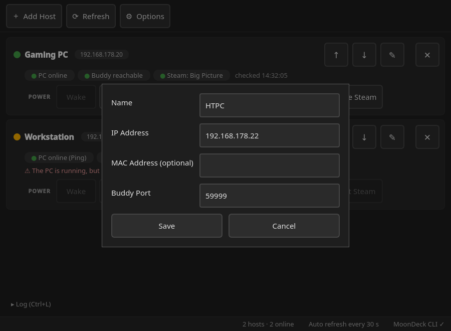
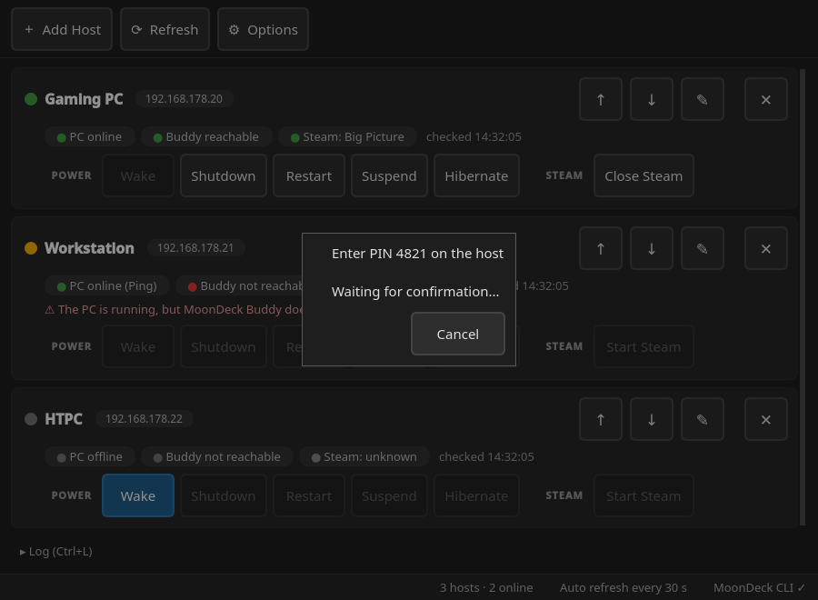
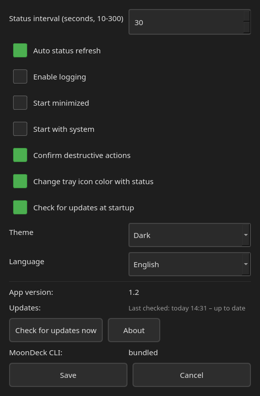
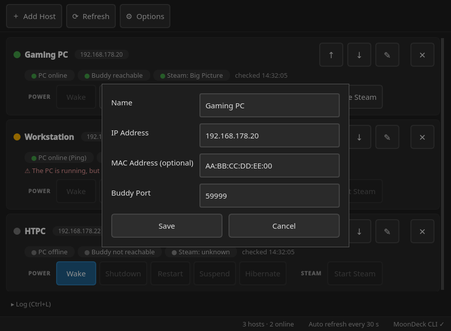
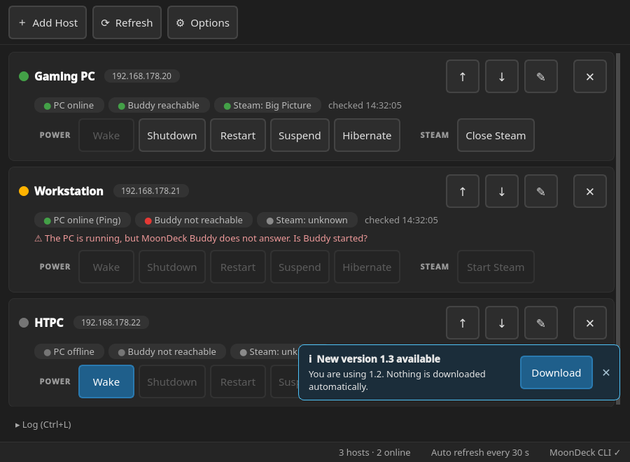
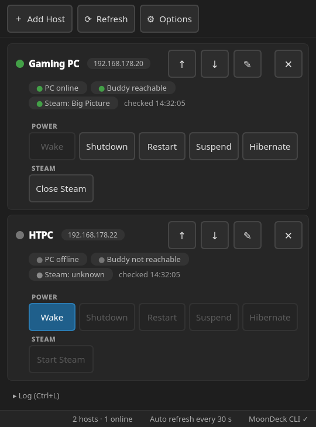

<div align="center">

# BuddyRemote

### Download. Run. Pair. Done.

**Simple remote PC control. No complicated setup.**

A lightweight, free and open-source **Linux GUI** for controlling **Windows and Linux PCs** on your home network via [MoonDeck Buddy](https://github.com/FrogTheFrog/moondeck-buddy).

[**Download the latest release**](https://github.com/deciderino/BuddyRemote/releases) · [Report an issue](https://github.com/deciderino/BuddyRemote/issues)

</div>

---

## What is BuddyRemote?

BuddyRemote lets you **wake, shut down, restart, suspend, or hibernate** your PCs, and **start or close Steam (Big Picture)** on them, from a simple graphical interface on Linux.

It was made for **Linux HTPCs, Steam Deck Desktop Mode, and home game streaming setups**—but you don't need a game streaming session to use it. Power controls work independently of Steam, Sunshine, Apollo, and Moonlight, as long as MoonDeck Buddy is available on the host.

**No SSH configuration. No manual MAC address lookup. No complicated command-line setup.**

> [!IMPORTANT]
> **For trusted local home networks only.** BuddyRemote uses MoonDeck Buddy's existing security model. Do not expose MoonDeck Buddy's service port directly to the internet.

<p align="center">
  
</p>

## Features

| Feature | What it does |
| --- | --- |
| **Wake-on-LAN** | Wake your Windows or Linux host remotely. |
| **Power controls** | Shut down, restart, suspend, or hibernate a host. |
| **Steam** | Start Steam in Big Picture mode on a host, or close it again. |
| **Live status** | Each host card shows whether the PC answers ping, whether MoonDeck Buddy is reachable, and whether Steam / Big Picture is running. Checked every 30 s by default (10–300 s, configurable). Buttons that can't do anything right now are greyed out, with a tooltip explaining why. |
| **Touch, keyboard & gamepad** | Large buttons (at least 48 px) for touch screens; full keyboard and gamepad navigation. |
| **Multiple hosts** | Manage several PCs from one window. |
| **Easy pairing** | Enter the host IP address and complete MoonDeck Buddy pairing. |
| **Automatic MAC detection** | Retrieve the host's MAC address through the MoonDeck CLI. |
| **Portable launch** | A single AppImage, no installation needed. You can also run it from the source folder without a system-wide installation. |
| **Automatic setup** | When running from source, BuddyRemote creates a Python virtual environment and installs the required dependencies on first launch. |
| **MoonDeck CLI setup** | The AppImage includes the MoonDeck CLI. When running from source, the CLI is downloaded automatically, with checksum verification when available. |
| **Update notice** | On startup, BuddyRemote asks GitHub whether a newer release exists and shows a small notice with a download link. Nothing is downloaded or installed automatically. You can turn this off in Options. |
| **System tray** | Keep BuddyRemote conveniently accessible. The tray icon turns green when MoonDeck Buddy is reachable on at least one host. |
| **German & English** | The language follows the system, or you can pick one in Options. |
| **Optional logs** | Enable application logging for troubleshooting. |

### Screenshots

<table>
  <tr>
    <th>Add a host</th>
    <th>Pairing</th>
  </tr>
  <tr>
    <td></td>
    <td></td>
  </tr>
  <tr>
    <th>Settings (Options)</th>
    <th>Host settings (✎ Edit)</th>
  </tr>
  <tr>
    <td align="center"></td>
    <td></td>
  </tr>
  <tr>
    <th>Update notice</th>
    <th>Narrow window</th>
  </tr>
  <tr>
    <td></td>
    <td align="center"></td>
  </tr>
  <tr>
    <th colspan="2">Light theme</th>
  </tr>
  <tr>
    <td colspan="2" align="center"></td>
  </tr>
</table>

<sub>Pairing starts after adding a host (BuddyRemote asks "Pair with this host now?"). The hosts, IP and MAC addresses and the PIN in the screenshots are examples.</sub>

## Getting started

**Download. Run. Pair. Done.**

**1. Set up MoonDeck Buddy on the host**

Install [MoonDeck Buddy](https://github.com/FrogTheFrog/moondeck-buddy) on the **Windows or Linux PC you want to control**.

**2. Download BuddyRemote**

Get `BuddyRemote-x86_64.AppImage` from [GitHub Releases](https://github.com/deciderino/BuddyRemote/releases) on your **Linux client**. Optionally, download `BuddyRemote-x86_64.AppImage.sha256` as well and check the download:

```bash
sha256sum -c BuddyRemote-x86_64.AppImage.sha256
```

**3. Run it**

Make the AppImage executable and start it:

```bash
chmod +x BuddyRemote-x86_64.AppImage
./BuddyRemote-x86_64.AppImage
```

Everything is bundled, including the MoonDeck CLI. On most desktops you can also make it executable in the file's properties and then double-click it.

<details>
<summary>Running from source instead</summary>

Download the source code (or clone the repository), open a terminal in the folder and start:

```bash
./BuddyRemote
```

The launcher sets up its own Python virtual environment, installs the required Python dependencies, and downloads the MoonDeck CLI when needed.

</details>

**4. Pair your host**

Enter the host's **IP address** and follow the pairing instructions. BuddyRemote retrieves the MAC address automatically through the CLI.

**5. Done!**

Control your host from the BuddyRemote GUI.

### Requirements

- **Client:** 64-bit (x86_64) Linux with glibc **2.34+** for the AppImage (e.g. Ubuntu 22.04+, Fedora 35+, Bazzite, SteamOS 3). Running from source needs Python **3.10+** with working `venv` support instead.
- **Host:** Windows or Linux with **MoonDeck Buddy** installed.
- Both devices connected to a **trusted local network**.
- Wake-on-LAN supported and enabled on the host if you want remote wake-up.

### Host setup tips

**Allow ping on Windows hosts.** BuddyRemote pings each host to tell "PC is on, but MoonDeck Buddy isn't answering" apart from "PC is off". Windows blocks ping by default. To allow it, enable the firewall rule **"File and Printer Sharing (Echo Request - ICMPv4-In)"**: go to *Windows Defender Firewall → Advanced settings → Inbound Rules* and enable it for the *Private* profile. Or run this in an administrator PowerShell; it works whatever your Windows language:

```powershell
Get-NetFirewallRule -Name FPS-ICMP4-ERQ-In | Enable-NetFirewallRule
```

If ping is blocked, BuddyRemote still works. It then only knows the PC is on while MoonDeck Buddy answers.

**Hibernate must be enabled on the host.** Windows often turns hibernation off. To turn it on, run this in an administrator command prompt:

```
powercfg /hibernate on
```

On Linux hosts, hibernation needs a swap partition or swap file at least as large as the RAM, and a configured resume device. If hibernation isn't available, BuddyRemote shows an error message and the PC keeps running.

> **First launch from source:** Internet access is needed to download Python dependencies and the MoonDeck CLI. The AppImage doesn't need this. After setup, BuddyRemote operates over your local network without requiring an ongoing internet connection.
>
> **Debian/Ubuntu-based systems:** If `venv` isn't available, you may need to install `python3-venv` through your package manager.

## Why I created BuddyRemote

I use a small Linux mini-PC as an **HTPC in my living room**, mainly to stream games from my more powerful gaming PCs.

Moonlight with Sunshine/Apollo works great for that. But I was missing something simple: **a convenient way to switch my gaming PCs on and off from the Linux desktop**.

Of course there are other ways—Wake-on-LAN utilities, SSH, scripts, phone apps. But I didn't want another complicated setup. I wanted a small GUI that I could open, click, and be done.

I already knew MoonDeck Buddy could handle remote power controls, so I wondered: **Why not make those features available through a simple standalone Linux interface?**

That's how BuddyRemote started.

### Built with AI, driven by an idea

I'm not a software developer. I built BuddyRemote with the help of AI: describing what I wanted, testing the results, reporting problems, and gradually adding features until the application worked the way I imagined.

At first it was just a tool for my own setup. After using it, I decided to share it in case it could help other Linux users who want straightforward PC control without extra configuration.

## Compatibility and intended audience

BuddyRemote has been **tested on Bazzite Linux**. It is designed to work across Linux distributions, but other distributions haven't been extensively tested yet. Reports from Ubuntu, Fedora, Arch, Linux Mint, Pop!_OS, SteamOS, and others are welcome.

It may be especially useful for:

- Linux HTPC and living-room PC users
- Steam Deck users in **Desktop Mode**
- Moonlight / Sunshine / Apollo setups
- Steam Remote Play users
- Multi-PC gaming setups
- Anyone who wants a simple LAN power-control GUI

**Streaming software is optional.** MoonDeck Buddy is required on each host, but Steam, Moonlight, Sunshine, and Apollo do not need to be running for remote power controls.

### Window position on Wayland

On Wayland, BuddyRemote remembers its window size, but the position is chosen by the compositor, just like other native Wayland apps (Dolphin, Kate, Firefox). On X11 the position is remembered as well.

**KDE tip:** to always open BuddyRemote at a fixed spot, add a KWin window rule: *System Settings → Window Management → Window Rules → Add New*, window class `buddyremote`, then set **Position** and **Size** to **Remember**.

### Keyboard and gamepad

BuddyRemote is a normal desktop app, but it can also be used with the keyboard (arrow keys, Enter, Esc) or a gamepad: D-pad / left stick to move, **A** to select, **B** to go back. Gamepads (Xbox, PlayStation, Switch Pro, 8BitDo, Steam Deck, ...) are read directly through SDL2, so Steam does not need to be running. The input only applies while the BuddyRemote window is active. Moving or clicking the mouse hides the focus highlight; the next key or gamepad press brings it back without triggering anything.

When running from source, gamepad support needs the optional `PySDL2` and `pysdl2-dll` packages from `requirements.txt` (an existing `.venv` can be updated with `.venv/bin/pip install -r requirements.txt`). Without them, the app works as before, just without gamepad input.

## Security and intended use

**BuddyRemote is intended for trusted local home networks only.**

It relies on MoonDeck Buddy and the MoonDeck CLI for communication and authentication. It does not provide its own hardened remote administration protocol and **is not a replacement for SSH** or other security-focused solutions.

- Only use it on networks you trust.
- **Never expose MoonDeck Buddy's service port directly to the public internet.**
- Avoid using it on public or untrusted networks.
- Keep MoonDeck Buddy and your systems updated.

The goal is **convenience in a home setup**, not internet-facing remote administration.

## Free & open source

BuddyRemote is a small personal open-source project. Suggestions, bug reports, contributions, and compatibility feedback are welcome.

**The goal stays the same: keep it lightweight, easy to install, and easy to use.**

See the repository's [`LICENSE`](LICENSE) file for the applicable license terms.

---

<sub>BuddyRemote is an independent project using MoonDeck Buddy. It is not an official MoonDeck application and is not affiliated with the MoonDeck developers.</sub>
