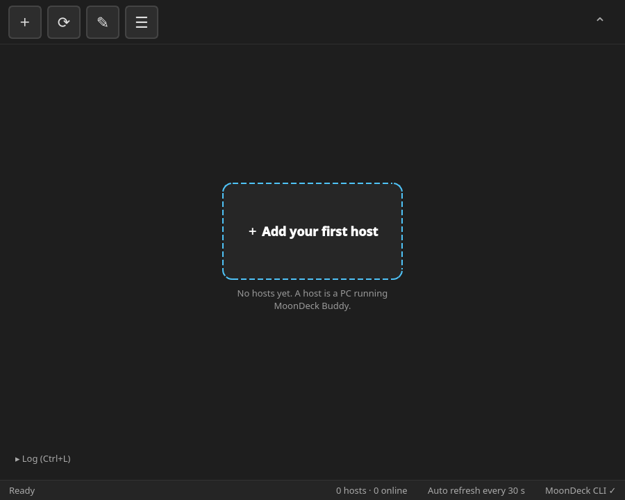
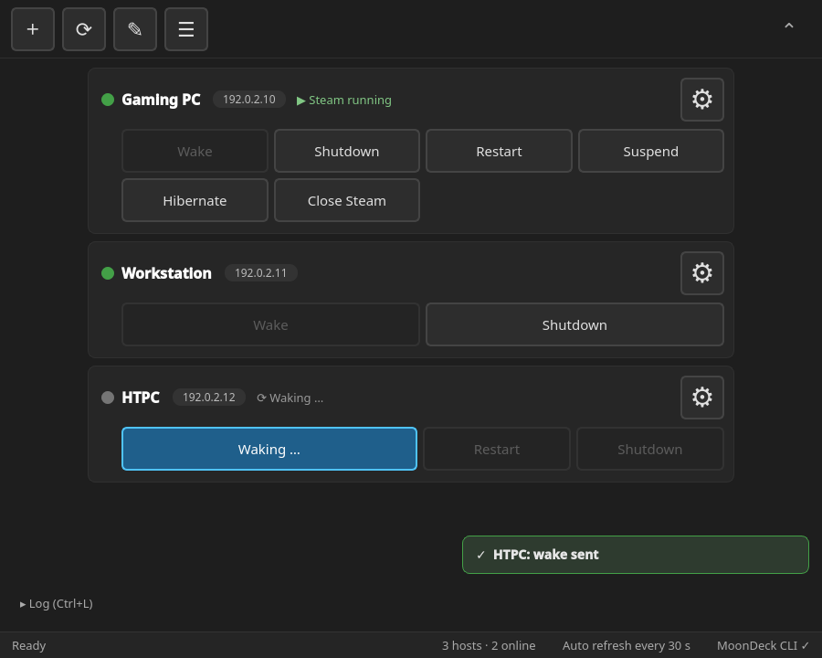
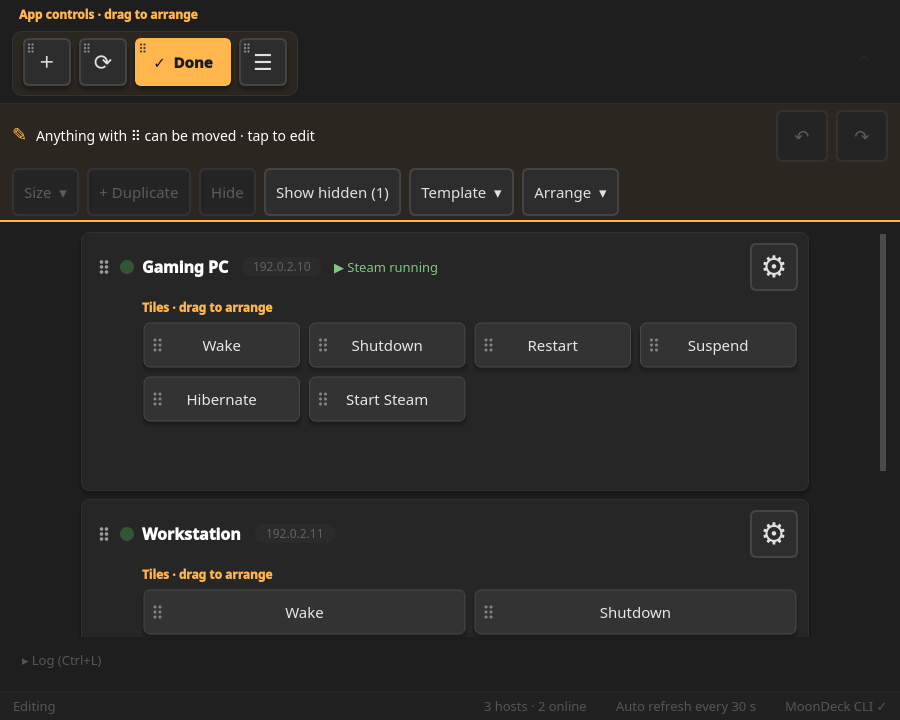
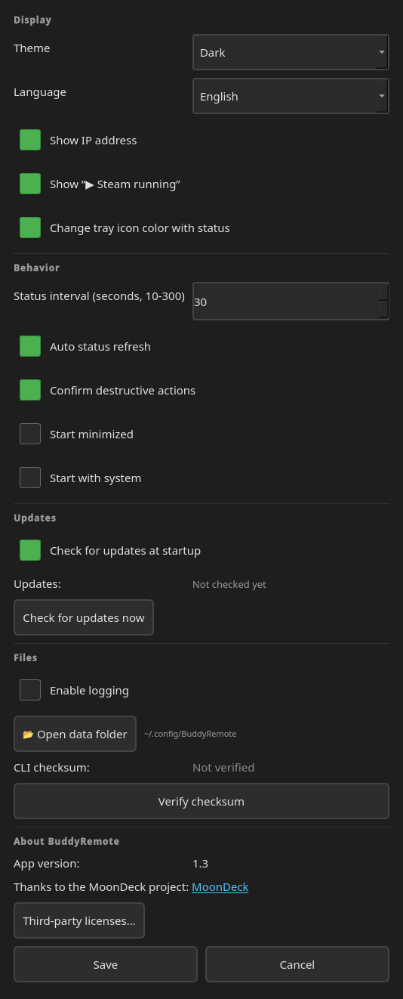

# BuddyRemote manual

This manual covers BuddyRemote **1.3** in detail. For a short overview, see the [README](../README.md).

**Contents**

- [Requirements](#requirements)
- [Installation](#installation)
- [Adding and pairing a host](#adding-and-pairing-a-host)
- [The main window](#the-main-window)
- [Tiles and actions](#tiles-and-actions)
- [Edit mode](#edit-mode)
- [Settings](#settings)
- [Keyboard, gamepad and touch](#keyboard-gamepad-and-touch)
- [Updating from 1.2](#updating-from-12)
- [Host setup tips](#host-setup-tips)
- [Troubleshooting](#troubleshooting)
- [Security](#security)
- [Third-party licenses](#third-party-licenses)

## Requirements

- **Client:** 64-bit (x86_64) Linux with glibc **2.34+** for the AppImage (e.g. Ubuntu 22.04+, Fedora 35+, Bazzite, SteamOS 3). Running from source needs Python **3.10+** with working `venv` support instead.
- **Host:** Windows or Linux with **[MoonDeck Buddy](https://github.com/FrogTheFrog/moondeck-buddy)** installed.
- Both devices connected to a **trusted local network**.
- Wake-on-LAN supported and enabled on the host if you want remote wake-up.

**Streaming software is optional.** MoonDeck Buddy is required on each host, but Steam, Moonlight, Sunshine, and Apollo do not need to be running for remote power controls.

BuddyRemote has been **tested on Bazzite Linux**. It is designed to work across Linux distributions, but other distributions haven't been extensively tested yet. Reports from Ubuntu, Fedora, Arch, Linux Mint, Pop!_OS, SteamOS, and others are welcome.

## Installation

### AppImage (recommended)

Get `BuddyRemote-x86_64.AppImage` from [GitHub Releases](https://github.com/deciderino/BuddyRemote/releases). Optionally, download `BuddyRemote-x86_64.AppImage.sha256` as well and check the download:

```bash
sha256sum -c BuddyRemote-x86_64.AppImage.sha256
```

Make the AppImage executable and start it:

```bash
chmod +x BuddyRemote-x86_64.AppImage
./BuddyRemote-x86_64.AppImage
```

Everything is bundled, including the MoonDeck CLI. On most desktops you can also make it executable in the file's properties and then double-click it.

### Running from source

Download the source code (or clone the repository), open a terminal in the folder and start:

```bash
./BuddyRemote
```

The launcher creates its own Python virtual environment, installs the required Python dependencies, and downloads the MoonDeck CLI when needed, with checksum verification when available. Nothing is installed system-wide.

> [!NOTE]
> **First launch from source:** Internet access is needed to download Python dependencies and the MoonDeck CLI. The AppImage doesn't need this. After setup, BuddyRemote operates over your local network without requiring an ongoing internet connection.
>
> **Debian/Ubuntu-based systems:** If `venv` isn't available, you may need to install `python3-venv` through your package manager.

## Adding and pairing a host

<p align="center">
  
  
</p>

1. Install and start MoonDeck Buddy on the host.
2. In BuddyRemote, click **＋ Add your first host** (or ＋ in the toolbar, **Ctrl+N**).
3. Enter a name and the host's **IP address**, and choose a tile template (you can change it later).
4. BuddyRemote asks **"Pair with this host now?"**. Confirm, then enter the PIN shown by BuddyRemote on the host. BuddyRemote waits until the host confirms.
5. The MAC address needed for Wake-on-LAN is retrieved automatically through the MoonDeck CLI. You can also enter it yourself.

To change a host's name, IP address, MAC address or Buddy port later, or to delete the host, use **⚙** on its card. Deleting asks for confirmation and can be undone from the message that appears afterwards (for a few seconds).

## The main window

<p align="center">
  
</p>

- **Toolbar:** ＋ add a host, ⟳ refresh the status, ✎ edit mode, ☰ settings. Hover a button to see its name and shortcut. **⌃** on the right collapses the toolbar into a slim strip; **⌄** brings it back. The shortcuts keep working while it is collapsed.
- **Host cards:** one card per PC with its name, optionally the IP address, and the tiles.
- **Status dot** next to the host name: **green** = ready, **orange** = the PC is on but MoonDeck Buddy isn't answering, **grey** = off. Hover the dot or the name for details (ping, Buddy, time of the last check). In the orange state, a line "Buddy not answering · ⓘ Details" explains what to check.
- **"▶ Steam running"** appears in the card header while Steam runs on the host (can be turned off in Settings).
- **Log:** "▸ Log (Ctrl+L)" opens the log panel. Drag its top edge to resize it; double-click the edge to reset the height.
- **Status bar:** the current state (Ready, Action running …, Editing), the number of hosts online, the refresh interval and whether the MoonDeck CLI is available.
- **System tray:** BuddyRemote can stay in the tray. The tray icon turns green when MoonDeck Buddy is reachable on at least one host.

The status is checked every 30 seconds by default (10–300 s, configurable). Buttons that can't do anything right now are greyed out; hover them to see why (for example "PC is already on" on Wake).

## Tiles and actions

| Tile | What it does |
| --- | --- |
| **Wake** | Wakes the host with Wake-on-LAN. |
| **Shutdown** | Shuts the host down. |
| **Restart** | Restarts the host. |
| **Suspend** | Puts the host to sleep. |
| **Hibernate** | Hibernates the host (must be enabled on the host, see [Host setup tips](#host-setup-tips)). |
| **Start Steam / Close Steam** | Starts Steam on the host and closes it again with the same tile. While Steam is running, the tile says "Close Steam". |
| **Online status** | Optional tile showing whether the PC and MoonDeck Buddy answer (hidden by default; the status dot shows the same). |

After a click, the tile shows what is happening (for example "Waking …") until the status changes, then a short message confirms that the action was sent. If something fails, an error message appears right away. Shutdown, restart, suspend, hibernate and closing Steam ask for confirmation first (can be turned off in Settings).

<p align="center">
  
</p>

### Templates

Pick a template when adding a host, or apply one later in edit mode:

- **Standard:** all power actions and Steam.
- **Minimal:** only Wake and Shutdown, as medium tiles.
- **Server:** Wake, Restart and Shutdown, without Steam.
- **Gaming:** large Wake and Steam tiles, the other actions small.

Templates only hide tiles; they never delete them. Hidden tiles come back with **Show hidden** in edit mode.

### Sizes

Tiles come in four sizes on a 4-column grid: **Small (1×1)**, **Medium (2×1)**, **Wide (4×1)** and **Large (2×2)**.

## Edit mode

<p align="center">
  
</p>

Press **✎** (Ctrl+E), or press and hold a tile on a touch screen. ✎ turns into **✓ Done**; Done or Esc leaves edit mode. Every change is saved immediately.

- **Move:** everything with a **⠿** grip can be dragged: tiles, whole host cards (by the header) and the toolbar buttons. While you drag a tile, the free places are outlined and the other tiles make room. An invalid drop springs back; Esc cancels a drag.
- **Select:** click a tile. The arrow keys move the selected tile; Ctrl+↑/↓ moves the focused card, Ctrl+←/→ a toolbar button.
- **Edit toolbar:** **Size**, **+ Duplicate**, **Hide** (or **Delete** for a duplicate), **Show hidden**, **Template**, **Arrange**. Right-click a tile for the same options.
- **Duplicates:** an action can be added up to 3 extra times, for example a second Wake tile.
- **Arrange:** the layouts **Compact** and **Spacious**, or arrange the tiles by how often you use them.
- **Undo / redo:** ↶ ↷ in the hint bar, or Ctrl+Z / Ctrl+Y (Ctrl+Shift+Z). The history covers one edit session.
- **Toolbar buttons** can be made small (icon only) or medium (icon and text) and reordered, but not hidden, so the app always stays usable.

<p align="center">
  
</p>

## Settings

Open the settings with **☰** (Ctrl+,).

<p align="center">
  
</p>

**Display**

- **Theme:** Dark or Light (takes effect after a restart).
- **Language:** English, German, Spanish, French, Italian, Czech, Japanese or Korean. By default the language follows the system. Spanish, French, Italian, Czech, Japanese and Korean are machine translations; corrections are welcome.
- **Show IP address:** when off, the IP is only shown in the tooltip of the status dot.
- **Show "▶ Steam running"** in the card header.
- **Change tray icon color with status.**

**Behavior**

- **Status interval** (10–300 seconds) and **Auto status refresh**.
- **Confirm destructive actions** (shutdown, restart, suspend, hibernate, closing Steam). Deleting a host always asks.
- **Start minimized** and **Start with system**.

**Updates**

- **Check for updates at startup:** BuddyRemote asks GitHub whether a newer release exists and shows a small notice with a download link. Nothing is downloaded or installed automatically.
- **Check for updates now.**

**Files**

- **Enable logging** for troubleshooting.
- **📂 Open data folder:** opens the folder with `config.json`, the log, `window.ini` and the CLI in your file manager. The path is shown next to the button.
- **CLI checksum:** verify the MoonDeck CLI.

**About BuddyRemote** shows the version, the thanks to the MoonDeck project and the **Third-party licenses…** viewer.

## Keyboard, gamepad and touch

BuddyRemote is a normal desktop app, but it can also be used with the keyboard (arrow keys, Enter, Esc) or a gamepad: D-pad / left stick to move, **A** to select, **B** to go back. Gamepads (Xbox, PlayStation, Switch Pro, 8BitDo, Steam Deck, ...) are read directly through SDL2, so Steam does not need to be running. The input only applies while the BuddyRemote window is active. Moving or clicking the mouse hides the focus highlight; the next key or gamepad press brings it back without triggering anything.

All buttons are at least 48 px for touch screens. In edit mode, press and hold to pick up a tile or card, drag it, and lift your finger to drop it.

| Shortcut | Action |
| --- | --- |
| **Ctrl+N** | Add a host |
| **F5** | Refresh the status |
| **Ctrl+E** | Edit mode |
| **Ctrl+,** | Settings |
| **Ctrl+L** | Show or hide the log |
| **Ctrl+Z / Ctrl+Y** (Ctrl+Shift+Z) | Undo / redo in edit mode |
| **Esc** | Leave edit mode or cancel a drag |

When running from source, gamepad support needs the optional `PySDL2` and `pysdl2-dll` packages from `requirements.txt` (an existing `.venv` can be updated with `.venv/bin/pip install -r requirements.txt`). Without them, the app works as before, just without gamepad input.

## Updating from 1.2

Your hosts and pairings are kept. On the first start, BuddyRemote converts each host once to the new tile layout (Standard template). Going back to 1.2 afterwards works, but duplicates and usage counts are lost.

## Host setup tips

**Allow ping on Windows hosts.** BuddyRemote pings each host to tell "PC is on, but MoonDeck Buddy isn't answering" apart from "PC is off". Windows blocks ping by default. To allow it, enable the firewall rule **"File and Printer Sharing (Echo Request - ICMPv4-In)"**: go to *Windows Defender Firewall → Advanced settings → Inbound Rules* and enable it for the *Private* profile. Or run this in an administrator PowerShell; it works whatever your Windows language:

```powershell
Get-NetFirewallRule -Name FPS-ICMP4-ERQ-In | Enable-NetFirewallRule
```

If ping is blocked, BuddyRemote still works. It then only knows the PC is on while MoonDeck Buddy answers.

**Hibernate must be enabled on the host.** Windows often turns hibernation off. To turn it on, run this in an administrator command prompt:

```
powercfg /hibernate on
```

On Linux hosts, hibernation needs a swap partition or swap file at least as large as the RAM, and a configured resume device. If hibernation isn't available, BuddyRemote shows an error message and the PC keeps running.

**Wake-on-LAN** must be enabled in the host's BIOS/UEFI and network adapter settings.

## Troubleshooting

- **Orange dot ("Buddy not answering"):** the PC is on, but MoonDeck Buddy doesn't answer. Check that MoonDeck Buddy is running on the host and that its port (default 59999) is allowed in the host's firewall.
- **Wake does nothing:** check that Wake-on-LAN is enabled on the host and that the MAC address in ⚙ is correct. Some PCs only wake from sleep, not from a full shutdown.
- **Hibernate fails:** see [Host setup tips](#host-setup-tips).
- **Need more details:** open the log (Ctrl+L), or turn on **Enable logging** in Settings and look into the data folder.

### Window position on Wayland

On Wayland, BuddyRemote remembers its window size, but the position is chosen by the compositor, just like other native Wayland apps (Dolphin, Kate, Firefox). On X11 the position is remembered as well.

**KDE tip:** to always open BuddyRemote at a fixed spot, add a KWin window rule: *System Settings → Window Management → Window Rules → Add New*, window class `buddyremote`, then set **Position** and **Size** to **Remember**.

## Security

**BuddyRemote is intended for trusted local home networks only.**

It relies on MoonDeck Buddy and the MoonDeck CLI for communication and authentication. It does not provide its own hardened remote administration protocol and **is not a replacement for SSH** or other security-focused solutions.

- Only use it on networks you trust.
- **Never expose MoonDeck Buddy's service port directly to the public internet.**
- Avoid using it on public or untrusted networks.
- Keep MoonDeck Buddy and your systems updated.

The goal is **convenience in a home setup**, not internet-facing remote administration.

## Third-party licenses

BuddyRemote is licensed under the **GNU General Public License v3.0** (see [`LICENSE`](../LICENSE)).

The AppImage bundles the following components unmodified, each under its own license. The full license texts are included in the AppImage (`usr/share/licenses/BuddyRemote`), in the source tree under [`packaging/linux/licenses`](../packaging/linux/licenses), and can be read in the app under *Settings → About BuddyRemote → Third-party licenses…*.

| Component | Used for | License |
| --- | --- | --- |
| [MoonDeck CLI](https://github.com/FrogTheFrog/moondeck) (by FrogTheFrog) | Talking to MoonDeck Buddy: pairing, power and Steam commands | GPL-3.0 |
| [Qt 6](https://www.qt.io/) | GUI toolkit | LGPL-3.0 |
| [PyQt6](https://www.riverbankcomputing.com/software/pyqt/) and PyQt6-sip | Python bindings for Qt | GPL-3.0 / BSD-2-Clause |
| [ICU 73.2](https://icu.unicode.org/) (bundled with Qt) | Unicode and language support | Unicode License (ICU) |
| [Python](https://www.python.org/) | Runtime | PSF License |
| [SDL2](https://www.libsdl.org/) and [PySDL2](https://github.com/py-sdl/py-sdl2) | Gamepad input | SDL2: zlib · PySDL2: Public Domain (CC0) / zlib |
| xcb-util libraries | X11 / XWayland support of Qt | MIT/X11 licenses, see the included copyright files |

The MoonDeck CLI is a nightly build of [MoonDeck](https://github.com/FrogTheFrog/moondeck) (commit [`00f8c31`](https://github.com/FrogTheFrog/moondeck/tree/00f8c31a6d9324878811178a2f8a319e4ca5c7c2)); its source code is available there. MoonDeck Buddy itself is not bundled; it runs on your hosts.

---

<sub>BuddyRemote is an independent project using MoonDeck Buddy. It is not an official MoonDeck application and is not affiliated with the MoonDeck developers.</sub>
